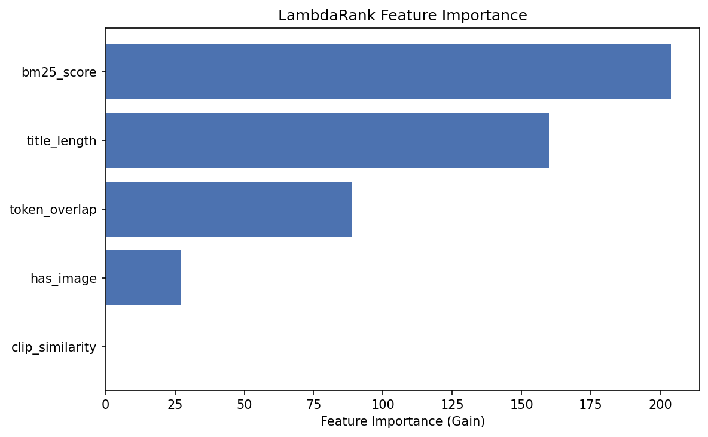

# Multimodal Product Reranker

> Does adding product-image information improve product search ranking?

## Problem

Product search engines return candidates based on text matching, but many purchase decisions are driven by visual attributes (color, pattern, material, style). This project evaluates whether adding CLIP image embeddings to a LightGBM LambdaRank reranker improves NDCG@10 on the Amazon ESCI dataset.

## Data

- **[Amazon ESCI](https://github.com/amazon-science/esci-data)**: Shopping Queries Dataset with query-product pairs labeled Exact / Substitute / Complement / Irrelevant.
- **[SQID](https://github.com/Crossing-Minds/shopping-queries-image-dataset)**: Precomputed CLIP embeddings for product images and queries from the same ESCI dataset.

## Approach

1. **Filter** ESCI to US locale, reduced version
2. **Sample** 3000 train + 1000 test queries (configurable)
3. **Join** SQID CLIP embeddings to product-query pairs
4. **Split** by query (train/val/test) — no query appears in multiple sets
5. **Build features**:
   - *Text*: BM25 score, query-title token overlap, title length
   - *Image*: CLIP cosine similarity, has_image flag
6. **Train** LightGBM LambdaRank with early stopping
7. **Evaluate** NDCG@10 per query, with ablation across variants

### Ablation Variants

| Variant | Features |
|---------|----------|
| `random` | Random scores (baseline) |
| `bm25_only` | BM25 score only (baseline) |
| `text_only` | BM25 + token overlap + title length |
| `image_only` | CLIP similarity + has_image |
| `text_plus_image` | All 5 features |

## How to Run

```bash
# 1. Install
make setup        # or: pip install -e ".[dev]"

# 2. Run the full pipeline
make all          # downloads data, builds dataset, trains, evaluates, analyzes

# Individual steps
make data         # download ESCI + SQID
make build        # build processed dataset
make train        # train models + ablation
make evaluate     # statistical tests
make analyze      # error analysis + plots

# Quality checks
make lint         # ruff check + format
make test         # pytest
```

## Project Structure

```
multimodal-product-reranker/
├── configs/default.yaml          # All experiment parameters
├── data/{raw,interim,processed}/ # Data (gitignored)
├── docs/
│   ├── architecture.md           # Pipeline diagram
│   ├── data_notes.md             # Real data observations
│   ├── experiment_log.md         # Run history
│   └── interview_notes.md        # Pitch and Q&A
├── reports/
│   ├── figures/                  # Feature importance, etc.
│   └── results.md                # Ablation + CI + analysis
├── scripts/                      # Pipeline entry points
├── src/mmrerank/                 # Library code
│   ├── config.py                 # Typed YAML config
│   ├── data/                     # Loaders, sampling, join, splits
│   ├── features/                 # Text + image feature builders
│   ├── models/                   # LambdaRank + baselines
│   └── evaluation/               # NDCG, ablation, stats, analysis
└── tests/                        # 51 tests, synthetic fixtures only
```

## Results

Real experiment results evaluated on the held-out test split (1,206 test queries, 23,870 query-product pairs) across 3 random seeds:

### Ablation Summary

| Variant | NDCG@10 Mean | NDCG@10 Std | Features |
|---------|:---:|:---:|---|
| **`text_only`** | **0.6804** | 0.0000 | BM25 score + token overlap + title length |
| **`text_plus_image`** | **0.6798** | 0.0000 | All text features + CLIP cosine similarity + has_image |
| **`bm25_only`** | **0.6735** | 0.0000 | BM25 score only |
| **`image_only`** | **0.5996** | 0.0000 | CLIP similarity + has_image |
| **`random`** | **0.5833** | 0.0041 | Uniform random baseline |

### Statistical Significance (Paired Bootstrap)
- **NDCG@10 Delta (`text_plus_image` − `text_only`):** `-0.0006`
- **95% Bootstrap Confidence Interval (10,000 resamples):** `[-0.0062, +0.0050]`
- **p-value:** `0.4103` (the overall delta across all generic queries is not statistically significant at $\alpha = 0.05$)

### Visual vs. Non-Visual Query Subgroups
- **Visual queries (116 queries):** NDCG@10 = `0.5637`
- **Non-visual queries (1,090 queries):** NDCG@10 = `0.5988`
- Queries with explicit visual intent (e.g. *pool cover*, *silk bodysuit*, *christmas disney long sleeve shirt*) show large positive gains (up to `+0.4057` NDCG lift), while generic brand or model queries with missing product images suffered degradation.



## Metric

**NDCG@10** per query, averaged. ESCI gain mapping: E=1.0, S=0.1, C=0.01, I=0.0.

Statistical significance via paired bootstrap confidence interval (10,000 samples, 95% CI).

## Limitations

- **No fine-tuned embeddings**: Uses precomputed CLIP from SQID — a fine-tuned model would likely do better.
- **CPU only**: Designed for laptop-scale; uses a configurable subset (default 4000 queries).
- **Simple text features**: BM25 + token overlap are basic; neural text features could improve.
- **Missing images**: Products without SQID embeddings get NaN similarity — imputation strategies not explored.

## Next Steps

- Fine-tune CLIP on ESCI product images
- Add product description and brand as text features
- Explore cross-attention between query text and product image
- Evaluate on the full (non-reduced) dataset
- Serve predictions via a lightweight API

## License

MIT
